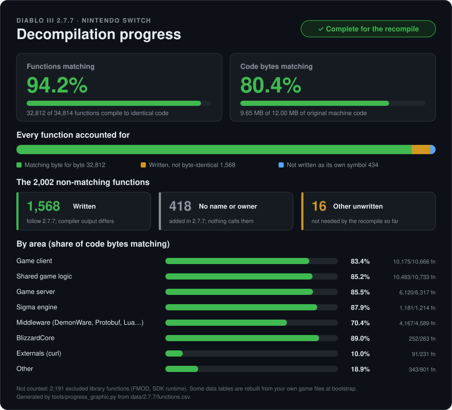

# NSDiablo3Decomp

A C/C++ decompilation of **Diablo III 2.6.2 for Nintendo Switch**. This target
ships matching NSS debug files with DWARF types, symbols and ownership information,
which made evidence-based recovery of every function body possible.

> **Not affiliated with Blizzard Entertainment or Nintendo.** This is an unofficial
> fan project for research and preservation, not endorsed by either company.
> Diablo is a trademark of Blizzard Entertainment, Inc.; Nintendo Switch is a
> trademark of Nintendo. This repository contains no game executables, assets, data
> files, keys or Nintendo SDK files. Building it needs your own legally obtained copy
> of Diablo III: Eternal Collection for Nintendo Switch. The MIT licence in
> [`LICENSES/`](LICENSES/) covers only the project's own tooling, as listed in
> [`REUSE.toml`](REUSE.toml); it grants no rights in the game.

## This branch: 2.7.7

This `port-2.7.7` branch moves the decompilation to the later **2.7.7** update
(`C2.7.7.92380`), the version the
[NSD3Recomp `support-2.7.7` branch](https://github.com/loremipsum1077/NSD3Recomp/tree/support-2.7.7)
builds. 32,766 of the game's functions match the 2.7.7 binary byte for byte; the rest
are written to 2.7.7's behaviour without matching exactly, and every game function the
recompile needs is present. The 2.6.2 status below is for the `dev` branch. How the port
was made, and what is still open, is in [docs/port_2_7_7.md](docs/port_2_7_7.md).

2.7.7 ships no debug (`.nss`) file, so the game-data step below needs **two** dumps
of your own copy: the cartridge version 2.6.2 (laid out as described below), and the
game's program after updating to 2.7.7.

1. Do the 2.6.2 steps below up to and including `python3 setup.py`, which also fetches
   the pinned `nx2elf`.
2. Convert the 2.7.7 update's `exefs/main` and check it (on Linux, use the `linux` folder):

   ```sh
   toolchain/nx-decomp-tools-binaries/macos/nx2elf /path/to/2.7.7/exefs/main --export-elf data/2.7.7/main.elf
   shasum -a 256 data/2.7.7/main.elf   # b462b3f68d0afc80eb2331b2b18c96a86046ef5a459bedc2439aa7959cfa13c5
   ```

3. Generate the game data for 2.7.7. The first command proves the tables against the
   2.6.2 dump, then replaces the ones 2.7.7 changed from `data/2.7.7/main.elf`; the
   second writes the 2.7.7 protobuf bindings:

   ```sh
   python3 tools/bootstrap_game_data.py /path/to/2.6.2 --build-protoc
   python3 tools/bootstrap_protobuf.py
   python3 tools/bootstrap_protobuf.py --check   # 0 of 48 differ
   ```

That is all NSD3Recomp needs: point it at this checkout. To build the Switch binary
itself and compare it with the original, see
[Setting up a checkout](docs/port_2_7_7.md#setting-up-a-checkout) (2.7.7 uses clang
7.1.0).

## Project status

The decompilation is **complete as far as it will go**: every function in the game
is either matching byte for byte, written with a documented reason it does not match,
or accounted for as code the compiler emits elsewhere. Some game data is not shipped
here and is rebuilt locally from your own game files (see
[Generate private build inputs](#generate-private-build-inputs)).

<!-- progress:start -->
   

<p align="center"></p>

| | Functions | Original code |
|---|---:|---:|
| **Matching byte for byte** | 33,729 (98.1%) | 10,794,444 B (92.6%) |
| Written, not byte-identical | 631 | 854,432 B |
| Not written as its own symbol | 8 | 2,536 B |
| **Total counted** | 34,368 | 11,651,412 B |

Of the 639 functions that do not match, **613** have no known behavioural difference, **26** possibly differ, and **0** are missing code the game needs. Each one is listed with its reason in [remaining_functions.md](docs/remaining_functions.md). 2,191 excluded library functions (FMOD, SDK runtime) are not counted; see [library_functions.md](docs/library_functions.md).

<sub>Regenerate with `python3 tools/progress_graphic.py` after landing functions.</sub>
<!-- progress:end -->

The remaining non-matching functions are accepted as they are. Most differ only
because of compiler version, register allocation or instruction ordering and layout,
and each one's cause is recorded. Matching them further is welcome but not required. See the
[exact-decompilation operating plan](docs/exact_decompilation.md) for the compiler,
proof and build-resource background. Native desktop recompilation was out of scope here; it is
being done in [NSD3Recomp](https://github.com/loremipsum1077/NSD3Recomp), which builds
this source for macOS. The [native subsystem harness](desktop/README.md) is preserved
for anyone who wants to take it further.

The focus is this base target first. Decompilation of later patches is a future
ambition, not a supported target today. The repository supplies no game originals,
assets, keys or playable game; contributors supply their own legally obtained
inputs. Open source-origin questions and third-party notices are listed in the [provenance inventory](docs/source_provenance.md).

Recovered implementation lives in [`src/`](src/) (game code in [`src/X/`](src/X/),
middleware in [`src/Contrib/`](src/Contrib/)); declarations primarily live in
headers alongside source under `src/`. [`include/`](include/) contains compatibility
headers. Original owner paths and function identities are indexed
in [`data/2.6.2/`](data/2.6.2/). See the [documentation index](docs/index.md)
for tooling and technical references.

A function is **O** when its compiled code equals the original: the checker
accepts it on the full build, or every instruction is equal and the checker's
only objection is a reference to something not yet defined. `python3 tools/land.py`
applies that rule ([landing](docs/decomp_workflow.md#landing)). Progress counts
are O functions and their original code bytes; they do not establish a
byte-identical rebuilt executable or a runnable game.

### License

The project-authored tools listed in [REUSE.toml](REUSE.toml) are available under the
[MIT License](LICENSES/MIT.txt). Reusers may modify, redistribute and sell them
with the copyright and permission notice. Third-party components carry their own
terms. See the [source provenance inventory](docs/source_provenance.md) for
upstream notices and the status of recovered game and SDK source.

### Getting the game files

Nothing from the game is included here, and nobody can give it to you. You make the
inputs yourself from a copy of the game you own:

1. **Own the game.** Diablo III: Eternal Collection for Nintendo Switch (title ID
   `01001B300B9BE000`), on cartridge or bought from the eShop.
2. **Have the right version: 2.6.2.52309.** The title screen shows it in small print
   at the bottom (`C2.6.2.52309`). Any other version, older or newer, will not
   match: the files are checked byte for byte.
   This is the version on the cartridge, with no updates installed. A copy that has
   been updated to a later version will not match.
3. **Dump it from your own Switch.** This needs a console that can run homebrew,
   and a dumping tool such as nxdumptool, which reads the installed game with your
   console's own keys. Follow that tool's documentation; this project does not
   provide keys, firmware or instructions for getting around the console's
   protections. Do not download the game or keys from anywhere else.
4. **Extract the ExeFS and RomFS** of the game's program (most dumping tools can do
   this directly) and lay them out as:

   ```
   <your folder>/
     exefs/main
     romfs/DiabloIIINX64r.nss
     romfs/...            (the rest of the RomFS)
   ```

   Allow about 30 GB of free space while extracting.
5. **Check them** with `python3 -B tools/verify_original_inputs.py --input-root <your folder>`.
   It needs no network or extra tools and reports exactly which file is missing or
   wrong. See [original input identity](docs/original_inputs.md) for the hashes.

Keep the dump private: do not commit it, upload it or share it.

### Generate private build inputs

From the repository root, point the bootstrap at your own extracted Switch 2.6.2
directory containing `exefs/main` and `romfs/DiabloIIINX64r.nss`.

```sh
python3 tools/bootstrap_game_data.py /path/to/game --build-protoc
```

The script verifies the game version and recovers the 24 game-specific Protobuf
schemas, controller maps, SWIG registrations and NVN graphics entry points locally.
It also recovers achievement events, font colors, hotbar anchors, Mirror Image attack names,
the Switch issuer mapping, and the sound, particle and saved-attribute tables.
It also writes the Lua table evidence used by the wrapper audit under `build/try/lua_wrapper_evidence/`.
It writes ignored files under `src/X/Common/`, where the existing build expects
them. It requires Python 3.10+ and an AArch64-capable `llvm-objdump`. On the first
run, `--build-protoc` downloads the checksum-pinned public Protobuf 2.6.0 release
and builds its compiler under `build/` using a host C++ compiler and Make.
For offline generation, pass `--protoc /path/to/protoc-2.6.0` or
`--protoc-archive /path/to/protobuf-2.6.0.tar.bz2`. The script checks generated
bindings against the hashes of the matching project sources before installing them.
When migrating an existing private checkout, `--bindings-from /path/to/old/src/X/Common/Protobuf`
reuses the 48 previously verified files and still regenerates every table from the game.
For a full build, place the verified inputs under `build/exefs/` and `build/romfs/` and run
`python3 setup.py`. With those inputs in place the wizard can run the bootstrap for you.

## Not maintained

This is a personal project, shared as it is. I will not be maintaining this
repository: issues and pull requests will not be reviewed or merged. If you want to
take it further, you are encouraged to do so in your own fork. The tools, the
[startup guide](docs/contributor_startup.md) and the
[decompilation workflow](docs/decomp_workflow.md) are all here for that; see
[CONTRIBUTING.md](CONTRIBUTING.md).

[Completion plan](docs/project_plan.md) · [Technical reference](docs/technical_reference.md)
· [Local reports and PR checks](docs/contributor_ci.md)
